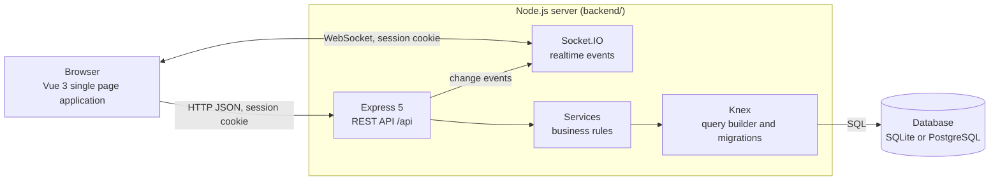
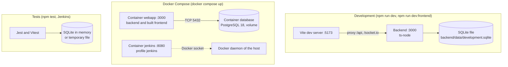
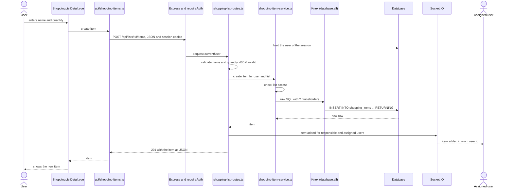
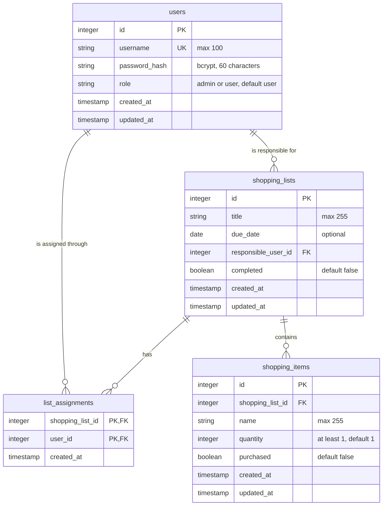

# Architecture and data model

This document describes which parts the Poschtilischte application consists
of, how they communicate and how the data is stored. Setup and operation are
described in the [README](../README.md).

## System overview

The application is a single page application in the browser that talks to one
Node.js server over HTTP and WebSocket. The server owns all business rules and
is the only component that accesses the database.

| Part        | Technology                                   | Location                        | Responsibility                                                |
| ----------- | -------------------------------------------- | ------------------------------- | ------------------------------------------------------------- |
| Frontend    | Vue 3, Vue Router 4, TypeScript, Vite        | `frontend/src/`                 | Views, forms, client-side routing, API and realtime client    |
| REST API    | Express 5, express-session                   | `backend/src/routes/`, `app.ts` | HTTP endpoints under `/api`, session login, input to services |
| Realtime    | Socket.IO 4                                  | `backend/src/realtime/`         | Pushes list and item changes to the affected users            |
| Services    | TypeScript                                   | `backend/src/services/`         | Business rules, validation, access checks, database access    |
| Data access | Knex 3 with `sqlite3` or `pg`                | `backend/src/db/`               | Connection, migrations, seed data, raw SQL wrapper            |
| Database    | SQLite 3 (development, tests), PostgreSQL 18 | `backend/data/`, Compose volume | Persistent storage of users, lists, items and assignments     |

## Runtime environments

The same code runs in three environments. Only the way the frontend is served
and the database client differ.

- **Development:** Vite serves the Vue application with hot reload and
  forwards `/api` and `/socket.io` to the backend on port 3000. The backend uses
  the SQLite file from `.env`.
- **Docker Compose:** The production image contains the compiled backend and
  the built frontend. Express serves the frontend files and the API on one
  port. The `database` container runs PostgreSQL; its port is not published.
  The optional `jenkins` container builds and tests the application through
  the Docker daemon of the host.
- **Tests:** The test suites create their own SQLite databases and need no
  running server or external database.

## Backend structure

`backend/src/` is organized in layers. Each layer only calls the layer below
it.

| Layer         | Files                                                                | Responsibility                                                                                  |
| ------------- | -------------------------------------------------------------------- | ----------------------------------------------------------------------------------------------- |
| Start         | `server.ts`, `app.ts`, `session.ts`                                  | Load `.env`, create the database, session, HTTP server, Express app and Socket.IO server        |
| Routes        | `routes/*-routes.ts`                                                 | Map HTTP endpoints to services, parse ids, send JSON and trigger realtime events                |
| Middleware    | `middleware/require-auth.ts`, `require-admin.ts`, `error-handler.ts` | Load the logged-in user from the session, check the admin role, turn errors into JSON responses |
| Validation    | `validation/*-validation.ts`, `errors/http-error.ts`                 | Check request bodies and raise errors with an HTTP status (400, 403, 404, 409)                  |
| Services      | `services/*-service.ts`                                              | Business rules and database access for users, lists, items and assignments                      |
| Authorization | `authorization/shopping-list-access.ts`                              | Decide list access: administrators, the responsible user and assigned users                     |
| Data access   | `db/database.ts`, `db/knex-config.ts`, `db/migrations/`, `db/seeds/` | Knex connection, raw SQL wrapper, schema migrations and seed data                               |
| Realtime      | `realtime/socket-server.ts`, `realtime/realtime-notifier.ts`         | Authenticate sockets, one room per user, send events to the users of a list                     |

The REST endpoints and their guards:

| Mount path         | Endpoints                                                                                                                                                | Guard                                       |
| ------------------ | -------------------------------------------------------------------------------------------------------------------------------------------------------- | ------------------------------------------- |
| `/api/health`      | `GET /`                                                                                                                                                  | none                                        |
| `/api/auth`        | `POST /login`, `POST /logout`, `GET /me`                                                                                                                 | `GET /me` needs a session                   |
| `/api/lists`       | `GET`, `POST /`, `GET`, `PATCH`, `PUT`, `DELETE /:id`, `POST`, `DELETE /:id/assignments`, `GET`, `POST /:id/items`, `PATCH`, `DELETE /:id/items/:itemId` | logged in, plus list access in the services |
| `/api/users`       | `GET /`                                                                                                                                                  | logged in                                   |
| `/api/admin/users` | `GET`, `POST /`, `PATCH`, `DELETE /:id`, `PUT /:id/password`                                                                                             | logged in and role `admin`                  |

In production (`NODE_ENV=production`) Express additionally serves the built
frontend from `frontend/dist` and answers every other `GET` path with
`index.html`, so the Vue router can handle it. The request and response bodies
of the API are described in the [README](../README.md#api).

## Frontend structure

| Part       | Files                                                                                   | Responsibility                                                                                    |
| ---------- | --------------------------------------------------------------------------------------- | ------------------------------------------------------------------------------------------------- |
| Shell      | `App.vue`, `main.ts`                                                                    | App bar, router view, starts the realtime connection for the logged-in user                       |
| Router     | `router.ts`, `auth/session.ts`                                                          | Routes `/`, `/lists/new`, `/lists/:id`, `/lists/:id/edit`, `/admin/users`, `/login` and the guard |
| Views      | `views/*View.vue`                                                                       | One view per route: dashboard, login, list form, list detail, user administration                 |
| Components | `components/*.vue`                                                                      | Cards, list detail, forms, admin user rows, realtime notification toast                           |
| API client | `api/http.ts`, `api/auth.ts`, `api/shopping-*.ts`, `api/users.ts`, `api/admin-users.ts` | `fetch` with relative `/api` paths and the session cookie, errors as `ApiError`                   |
| Realtime   | `realtime/socket.ts`, `realtime/events.ts`                                              | Socket.IO client and typed events for the dashboard, the detail view and the toast                |

The router guard asks `GET /api/auth/me` for the current user. Without a
session it redirects to `/login`; `/admin/users` is only open for
administrators.

## Request flow

The example shows how adding an item travels from the Vue component to the
database and back, and how the other users of the list are informed.

1. The component calls a function of the API client. It sends JSON with the
   session cookie (`credentials: "same-origin"`); in development Vite forwards
   the request to the backend.
2. Express parses the body and restores the session. `requireAuth` loads the
   user; a missing session ends with `401 {"error":"Authentication required"}`.
3. The route converts the path parameters, validates the body with the
   functions in `validation/` and calls the service. The service checks the
   list access with `authorization/shopping-list-access.ts`.
4. The services reach the database in two ways, both through Knex: raw SQL with
   `?` placeholders through `database.all()`, used by the item service and for
   reads with joins, and the Knex query builder with transactions, used by the
   list and user services where several tables change together. Knex adapts
   the SQL to SQLite or PostgreSQL.
5. The route answers with JSON. Most errors are thrown as `HttpError` and turned into
   `{"error": "..."}` with the matching status by `error-handler.ts`;
   unexpected errors become `500`.
6. After a successful change the route sends a realtime event to the
   responsible user and all assigned users of the list.

## Realtime communication

Socket.IO runs on the same HTTP server and port as Express. It shares the
express-session middleware, so a socket is only accepted with a valid login
session. Every socket joins the room `user:<id>` of its user.

| Event           | Sent when                                                    | Receivers                                                   |
| --------------- | ------------------------------------------------------------ | ----------------------------------------------------------- |
| `list:assigned` | A user is assigned to a list                                 | The responsible and assigned users of the list              |
| `list:updated`  | A list is created, changed, deleted or an assignment removed | Responsible and assigned users, before and after the change |
| `item:added`    | An item is added                                             | Responsible and assigned users of the list                  |
| `item:updated`  | An item is changed or marked as purchased                    | Responsible and assigned users of the list                  |
| `item:deleted`  | An item is deleted                                           | Responsible and assigned users of the list                  |

The frontend connects in `App.vue` after the login. The dashboard and the list
detail update their data on these events, and `RealtimeNotificationToast.vue`
shows a short notice.

## Data model

The schema is created by the Knex migrations in `backend/src/db/migrations/`
and is the same for SQLite and PostgreSQL. `npm run db:seed` fills it with the
development data from `backend/src/db/seeds/`.

| Table              | Purpose                                                   | Keys and constraints                                                                                                                                        |
| ------------------ | --------------------------------------------------------- | ----------------------------------------------------------------------------------------------------------------------------------------------------------- |
| `users`            | Login accounts with role `admin` or `user`                | `username` unique. `password_hash` must be exactly 60 characters and start with `$2a$`, `$2b$` or `$2y$`, so only bcrypt hashes and no plaintext are stored |
| `shopping_lists`   | A shopping list with title and due date                   | `responsible_user_id` → `users.id`, `ON DELETE RESTRICT`: a user who is responsible for a list cannot be deleted                                            |
| `shopping_items`   | The articles of a list                                    | `shopping_list_id` → `shopping_lists.id`, `ON DELETE CASCADE`. `quantity` must be positive                                                                  |
| `list_assignments` | Users who may work on a list besides the responsible user | Composite primary key `(shopping_list_id, user_id)`, both foreign keys `ON DELETE CASCADE`                                                                  |

Relationships:

- A user is responsible for any number of lists; every list has exactly one
  responsible user (1:n).
- A list contains any number of items; deleting the list deletes its items
  (1:n).
- Users and lists are additionally connected many-to-many through
  `list_assignments`; deleting a list or a user removes the assignment.
- All foreign keys use `ON UPDATE CASCADE`. All tables except
  `list_assignments` have an auto-increment `id`.
